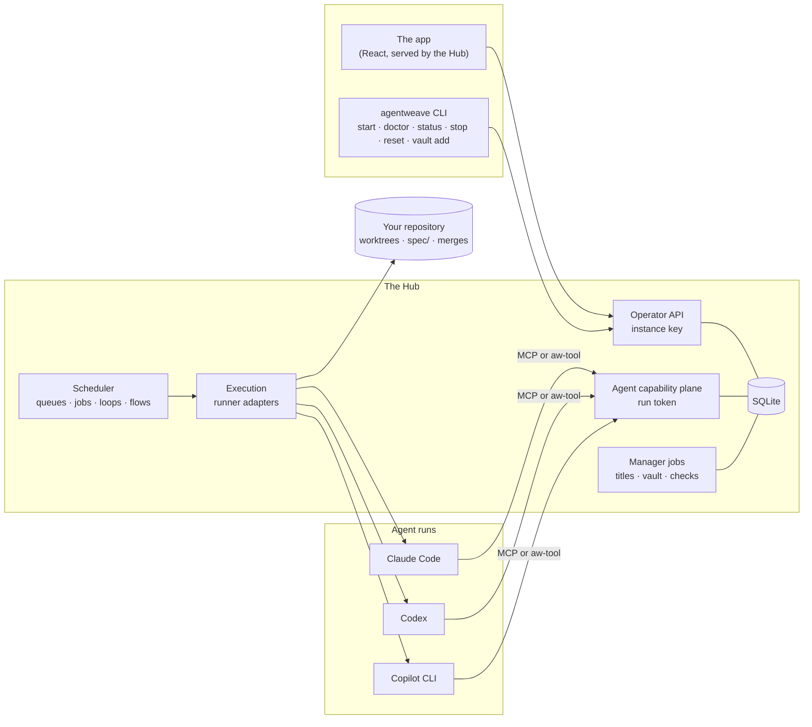

# Architecture overview

AgentWeave has one runtime: the **Hub**, a FastAPI process with a SQLite database that owns
execution, state and identity, and serves the React app.

## Trust boundaries

There are exactly two kinds of caller, and they never share a credential.

- **The operator** authenticates with one instance key (`aw_live_…`), discovered automatically by
  the local app. Project identity is explicit in every operator URL and never comes from the key.
- **An agent run** gets its own short-lived token (`aw_run_…`, stored only as a digest), bound to
  its project, its agent and that one run. It is valid only while the run is live.

**Identity is never accepted from a request body or header.** That single rule is what makes every
attribution in the product trustworthy: an agent cannot claim to be another agent, approve its own
work, or decide its own evidence.

## The agent capability plane

One HTTP contract, `/api/v1/agent-actions`, with two ways in:

- **MCP**, injected into CLIs that accept it, through a pinned copy of the tool server under
  `~/.agentweave/hub/tool-server/<digest>/`;
- **`aw-tool`**, the same program as a command on the run's `PATH`, for runs where MCP is not known
  to work.

Both are generated from one description of the [tools](../reference/agent-tools.md), so the two
renderings cannot drift apart. A run is told which one it has at the start of its turn.

## Projects

One Hub owns many projects. A project's database id is durable. Its working directory is a unique
binding recorded by `.agentweave/project.json`, so a renamed folder keeps its identity and a copied
folder cannot silently merge with the original.

Every filesystem operation resolves through the project's workspace service. The Hub process's own
working directory is never project identity. Frontend state keys and URLs carry the project id, and
the operator's event stream stamps every event with its project. In Docker, projects are confined
beneath one mounted workspace root.

## Execution

For each turn the Hub:

1. takes the next entry from the agent's **inbound queue** (from you, a peer, a job, a loop, a
   checkpoint, or an answer), within the hop budget and delivery cap;
2. checks the agent can launch, and holds the turn if a provider's allowance is spent or the token
   budget is reached;
3. prepares the workspace (the agent's or the task's worktree) and renders the turn context
   (project, task, team, instructions, tools, charter);
4. spawns the runner through its **adapter**, one per CLI, which owns launch, transport, event
   parsing, usage and posture;
5. streams normalized events, records usage and the trace, and records how the turn ended;
6. applies what the run did through the same governed services the operator uses: task
   transitions, evidence, merges.

Agent processes never poll for work and never touch the database. Everything they do goes through
the capability plane.

## Background work

- **The scheduler** fires jobs, loops and flows, retries held queues, and runs checks.
- **Manager jobs** are one-shot model calls the Hub makes for itself: conversation titles, vault
  distillation and reports, the spec vault check. They never appear as agent runs, and their spend
  is counted.
- **Traces** of every run and every Hub operation are kept locally, and can be exported over OTLP.

## The CLI

`agentweave` sets up and launches the instance and registers the directory it was run from.
`doctor`, `status`, `stop`, `reset` and `vault add` are the only subcommands. Operator collaboration
belongs to the app, and agent collaboration belongs to the capability plane.

## Repository components

| Path | What |
|---|---|
| `src/agentweave/` | The CLI (`agentweave-ai` on PyPI). Its own code imports only the standard library. |
| `hub/hub/` | The Hub: API, scheduler, execution, runner adapters, persistence, migrations. |
| `hub/ui/` | The React app, and its committed build in `hub/hub/static/ui/`. |
| `spec/` | AgentWeave's own specification corpus, managed through AgentWeave. |
| `docs/` | This site. |
