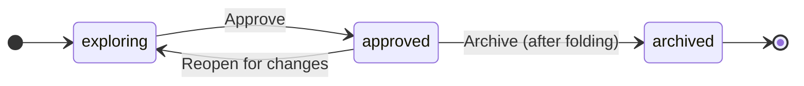

# Specifications

A specification document says what to build, precisely enough to check. In AgentWeave it is also
where traceability starts: every requirement gets an identifier, every task names the requirements
it serves, and every piece of evidence names the requirement it proves.

<figure class="aw-shot" markdown>

</figure>

## Kinds of document

| Kind | What it is | Who writes it |
|---|---|---|
| **Change** | A proposed change: summary, problem, scope and non-goals, requirements with scenarios, design notes, tasks, and how it will be delivered. | An agent or you |
| **Roadmap** | A large request split into ordered **slices**, each one a change of its own. | An agent or you |
| **Capability** | How one area of the product behaves *today*. Changes are folded into capabilities once they ship. | You (by folding) |
| **System map** | Orientation: the corpus's home page and area maps. | You |

Documents live in `spec/` in your project as `spec.json` files: the structured content plus a small
`hub` block with phase and rigor. The Hub renders them for reading, so diffs stay clean. Commit
`spec/` like any other source. See [Project files](../reference/project-files.md).

## The Spec home

With documents in the project, the **Spec** tab opens on a home page above the document list. It shows
what is **Building now**, what was **Recently built**, a map of how roadmaps, changes and capabilities
relate (hover a build to light up what it touches), and the project's **Capabilities**, each with a
count of changes waiting on it. Open anything from it.

### Starting a project with no specs

A project with no specification documents is offered a start instead of an empty page. There are two,
and the Hub marks the one it recommends:

- **Write down what the existing code does.** A profile reads the code and writes a **system map**:
  its areas, and the capabilities it proposes, with one capability draft each. You
  review every draft. Only approving it and folding it makes it a capability.
- **Plan a new project.** A profile interviews you about the problem, its users, scope and
  non-goals, then writes a roadmap of slices.

Choosing **Start…** asks which profile does it, and opens that profile's new thread. With no profile
in the project there is nothing to start, and the page offers to add one. A system map lists its
proposed capabilities, each with the state of its draft: no draft yet, exploring, approved, current or
declined.

## Writing one with an agent

You never fill in a form. You describe the change in a conversation:

1. In the composer, press **Explore** (or attach an existing document) and write your request.
2. The agent creates the document and works through it with you. In this kind of turn the agent
   gets **no file-edit tools**: it writes the document through the Hub, which validates it, gives
   each requirement an identifier, and writes the file.
3. Where something is genuinely undecided, the agent asks you with a question card instead of
   guessing, and asks only what only you can decide.

### How the interview goes

The agent is curious first, then relentless. At **intake**:

1. **Playback.** Its first reply says, in plainer words than yours, what it understood you are
   trying to achieve and why, without saying how it would be built, and asks whether it got that
   right. It stops there. Once you confirm, it writes that as the document's problem.
2. **How it works today.** On every size, before any requirement exists, it writes how the part of
   the system your request touches works now (citing files and lines), how the change fits on top
   as a before and after sketch, and what existing behaviour it would change.
3. **A few deep questions.** Each names the finding that makes it matter, the code it read, behaviour
   it observed or an earlier answer, and the ones others depend on come first. At most three per
   reply. Where the question is about what you want, you are asked to describe it in your own words
   before any options are offered; options with a recommendation appear only for a fork between
   alternatives it has named. The agent challenges the request's premise at least once, and asks
   about failure modes, boundary cases and conflicts the code shows.
4. **Ideas as nudges.** Ideas beyond your request are listed apart from the questions, and nothing
   goes into the requirements or scope until you pick it up.

Every intake reply after the playback says which of the coverage items are still open (what you want
and why, who it affects, scope boundaries, failure and boundary cases, conflicts with existing
behaviour, what success looks like) and lists each assumption the agent is making in place of an
answer.

You are not asked to press continue. When a step's output is written and the agent has no question,
it calls `advance_spec_step` itself and says which step it moved to. It records the **size** with its
reason and tells you, rather than asking you to confirm it. It asks whether the work is already built
only when it found candidate commits, and it picks the task builders and checkers from its own
knowledge of the project. At the requirements and acceptance steps it shows you only what it is
unsure of or what contradicts something, the assumptions behind them, and the acceptance drive, not
the full list.

At the tasks step the author is told every profile's whole pool (each runner, its model, its effort
when set, and which entry is the default), so a task that needs a non-default entry names it with
`builder_entry` or `checker_entry`, and the reason for the pick is stated in terms of that entry's
model.

A requirement may list, in `facts`, the vault facts the author used for it, by id. A requirement
nothing in the vault backs lists none, and nothing warns about that.

A change moves through a short **journey** of steps. Its length follows its size:

| Size | Steps |
|---|---|
| **Fix** | intake → tasks → delivery |
| **Small** | intake → requirements and acceptance → tasks → delivery |
| **Large** | intake → requirements → acceptance → approach → tasks → delivery |

A project can add its own steps under **Project settings → General → Spec steps**.

### The pre-mortem

The **Pre-mortem** is a manager job, switched on or off per project under **Project settings →
Manager**, with its own runner and model. When it runs, a fresh reader takes the drafted
requirements and criteria and the code, assumes the change shipped and failed, and records how.
You choose when it fires: **Automatic** (when the document leaves the step that writes its
acceptance criteria) or **Button only**.

- It fires on its own only for a document with no completed pre-mortem. A firing that failed does
  not count, so the next leave of the step fires again. Once one has completed, it runs again only
  when you press **Run a pre-mortem** on the document's page.
- The document's author is shown the unanswered findings at the start of every turn on that
  document, each with its number, the requirement it names and its story. It fixes what it can, or
  brings the rest to you as questions, then answers each finding, or all at once, with a note of
  what it did. Only the author answers: a profile that saved the document's content before its
  first approval, from whichever conversation it is in. The findings follow the document when a
  conversation is continued from a checkpoint.
- Until every finding is answered, the **Check** and the author's save report a **pre-mortem gap**
  naming how many are unanswered, and the document is not ready to approve. You can still approve
  over it.
- The pre-mortem shows at the end of the **Document** tab in a conversation's side panel, and on the
  spec page: whether one has run, is running or has findings, how many are answered, and each
  finding with its requirement, story, and its answer's note, author and time.

### Confirming acceptance criteria

Before a change can be approved, each of its acceptance criteria must be **confirmed** against the
current code. The author reads the code each criterion is about and records, for each, whether it is
**new** (the behaviour does not exist yet, so the acceptance drive's check for it must fail on
today's code) or a **guard** (it already holds, and the document marks the criterion as a guard).
This is what stops a change from being built for behaviour that already exists. Any profile may
confirm, while the document is still being explored.

A confirmation stops counting when its criterion is reworded or its guard flag changes; it must then
be confirmed again. **Approval is refused until every criterion has a current confirmation, and
*Approve anyway* does not pass it.** The refusal, `criteria_unconfirmed`, names the criteria left.

### Requirements and scenarios

A requirement is one statement with a modal (MUST, SHALL, SHOULD or MAY), for example: *"Tax MUST be
computed as the invoice subtotal multiplied by the region's rate and rounded to the cent with
ROUND_HALF_UP."* The Hub mints its identifier (`FR-2`) and keeps it for life. Removed requirements
are retired, never reused.

A requirement can also list the vault `facts` it rests on. The spec vault check separately names
facts that *possibly* back each requirement; the full spec page shows them beside it, marked as
possible and not confirmed. See [Knowledge vault](knowledge-vault.md#checking-specifications-against-the-vault).

Each requirement has one or more **scenarios**, written as Given / When / Then. A scenario can also
say **how to check** it and **who checks** it (an agent or you).

## Phases

The document's primary button follows its phase:

- **Check** (while it is written). Lists what still blocks approval, exactly as the agent's own
  save reports it, and moves nothing: the agent keeps writing while you look.
- **Approve** (from draft). Names the version you read, and is refused if the document changed
  since. **Approval creates the document's tasks**, unassigned, with their dependencies, acceptance
  criteria and requirement links, and starts nothing. If intake recorded the work as already built,
  approval offers to close the tasks as built at the commits it named.
- **Build…** (approved, no flow yet). Starts building it as the document recommends: the flow its
  recommended build describes, or the tasks left on the board. It opens with the recommendation and
  its reasons filled in. **Approve and build…** does both in one action.
- **Start a flow…** (in the menu, approved, no flow yet). Configure a flow by hand. See
  [Jobs, loops and flows](jobs-loops-flows.md).
- **Fold into capability…** (approved, every task decided). Merge what shipped into the capability
  it changed.

**Only you approve, archive or retire.** An agent can write and revise a draft, but nothing an agent
sends can move a document's phase.

### Gaps are warnings, not walls

When you approve, the Hub lists what is missing: a MUST with no scenario, a scenario nobody is
named to check, steps of the journey that were skipped, a requirement no task serves. You can fix
them, or press **Approve anyway**. The gaps you overrode are recorded on the document and shown
beside its phase. Approval is refused outright only for real contradictions, such as a dependency
cycle or a task depending on something that does not exist.

<figure class="aw-shot" markdown>

</figure>

A gap you judge acceptable can be **acknowledged** instead of fixed. The author, or you, gives a
reason; the gap stays visible, listed apart from the open ones with the reason, who acknowledged it
and when, and no longer counts as open when the Hub says whether the document is ready to approve.
An acknowledgement holds only while the same gap is still reported: fix it and it is dropped, and a
gap that comes back is open again. Refusals, unreviewed amendments and vault warnings cannot be
acknowledged by an agent.

Approving again after edits is safe. It refreshes the open tasks instead of duplicating them.

## Rigor

Phase says *whether you agreed*. Rigor says *what happens to work that does not satisfy it*. Set it
from the chip beside the phase:

| Rigor | Agent edits | Approving a task |
|---|---|---|
| **Sketch** (default) | Apply at once. | Not gated, except that evidence someone *rejected* always blocks. |
| **Contract** | Arrive as **proposals** you accept or reject, one per requirement changed. | Unverified requirements are reported, not blocking. |
| **Gate** | Proposals, as above. | **Refused** while any requirement the task serves is not verified. |

Raising rigor needs well-formed requirements. Lowering it needs a reason, and keeps every link and
piece of evidence. Every change is in the document's rigor history.

## Coverage

The health line under the title says where the document stands, for example
*1/4 verified · 3 in progress · No drift · Vault agrees · 1/2 tasks decided*. Open any part of it
for detail. Each requirement is in exactly one coverage state:

| State | Meaning |
|---|---|
| **Verified** | Accepted evidence for the current wording. |
| **Awaiting review** | Evidence recorded, not yet decided. |
| **In progress** / **Not started** | A task serves it, and has or has not started. |
| **No work linked** | Nothing serves it yet. |
| **Rejected** | Its evidence was rejected. |
| **Stale** | Evidence exists only for an older wording. |
| **Drifting** | Files its accepted evidence was about have changed since. |
| **Amendment not reviewed** | A tester changed its scenario, and you have not reviewed the change. |

Coverage also says whether verified work is **integrated**, meaning merged into your main branch.
Work verified on a branch is never mistaken for work that shipped. There is deliberately no
percentage.

Each requirement opens to its **story**: every wording it has had (as word diffs), who changed it,
and the evidence and tasks behind each version.

<figure class="aw-shot" markdown>

</figure>

## Drift

Accepted evidence watches the files it was about. If those files change later, **Scan for drift**
raises a candidate, and you decide what it means: **Spec updated**, **Code corrected**, or **No
change**. The Hub never resolves drift by itself.

## Testers amend, you review

A tester run (a review turn told to drive the built product) can amend an approved document with
what testing found: add a task, add or change a scenario. Amendments take effect at once, so the
work can continue, but each one reads *not reviewed* until you mark it reviewed. Until then, the
requirement it touches cannot verify. A tester can also report that a criterion **cannot be
satisfied** as written. You answer with **Amend criterion…**, **Accept and unblock**, or
**Reject…**. A builder can never amend.

## Folding into capabilities

When a change's tasks are all decided, **Fold into capability…** merges its requirements into the
capability document it changed. You can edit the keys and statements, and replace or retire what
the change superseded. Archiving a change requires either a fold, or an explicit "no capability
change" with a reason, so current behaviour never silently falls behind what shipped.

## Roadmaps

For work too large for one change, write a **roadmap**: ordered slices, each with its own change
document. When you approve a slice, **Draft the next slice** asks the slice's author to draft the
next one as soon as this one's tasks have closed.

A roadmap shows each slice's progress. A slice is **Not drafted**, **Drafting**, **Approved**,
**Building** or **Built**, and the roadmap shows the tasks on main out of the slice's total, what it
has cost so far (building, review, landing and mending), when it was built, and a link to its
build retrospective once one is written. A slice that is not drafted but whose earlier slices are
built is offered with **Draft this slice**, or **Not now**. One whose earlier slices are not built
shows what it waits for, and can be drafted early.
