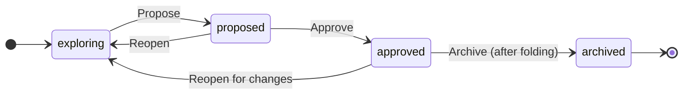

# Specifications

A specification document says what to build, precisely enough to check. In AgentWeave it is also
where traceability starts: every requirement gets an identifier, every task names the requirements
it serves, and every piece of evidence names the requirement it proves.

<figure class="aw-shot" markdown>

</figure>

## Kinds of document

| Kind | What it is | Who writes it |
|---|---|---|
| **Change** | A proposed change: summary, problem, scope and non-goals, requirements with scenarios, design notes, tasks, and how it will be delivered. | An agent or you |
| **Roadmap** | A large request split into ordered **slices**, each one a change of its own. | An agent or you |
| **Capability** | How one area of the product behaves *today*. Changes are folded into capabilities once they ship. | You (by folding) |
| **System map** | Orientation: the corpus's home page and area maps. | You |

Documents live in `spec/` in your project as `spec.json` files: the structured content plus a small
`hub` block with phase and rigor. The Hub renders them for reading, so diffs stay clean. Commit
`spec/` like any other source. See [Project files](../reference/project-files.md).

## Writing one with an agent

You never fill in a form. You describe the change in a conversation:

1. In the composer, press **Explore** (or attach an existing document) and write your request.
2. The agent creates the document and works through it with you. In this kind of turn the agent
   gets **no file-edit tools**: it writes the document through the Hub, which validates it, gives
   each requirement an identifier, and writes the file.
3. Where something is genuinely undecided, the agent asks you with a question card, one question at
   a time, instead of guessing.

A change moves through a short **journey** of steps. Its length follows its size:

| Size | Steps |
|---|---|
| **Fix** | intake → tasks → delivery |
| **Small** | intake → requirements and acceptance → tasks → delivery |
| **Large** | intake → requirements → acceptance → approach → tasks → delivery |

A project can add its own steps under **Project settings → General → Spec steps**.

### Requirements and scenarios

A requirement is one statement with a modal (MUST, SHALL, SHOULD or MAY), for example: *"Tax MUST be
computed as the invoice subtotal multiplied by the region's rate and rounded to the cent with
ROUND_HALF_UP."* The Hub mints its identifier (`FR-2`) and keeps it for life. Removed requirements
are retired, never reused.

Each requirement has one or more **scenarios**, written as Given / When / Then. A scenario can also
say **how to check** it and **who checks** it (an agent or you).

## Phases

The document's primary button follows its phase:

- **Propose** (from draft). The Hub checks the document and lists anything missing.
- **Approve** (from proposed). **Approval creates the document's tasks**, unassigned, with their
  dependencies, acceptance criteria and requirement links. If the document names a flow as its
  delivery, approval also starts the flow.
- **Start a flow…** (approved, no flow yet). Have a flow work the tasks for you. See
  [Jobs, loops and flows](jobs-loops-flows.md).
- **Fold into capability…** (approved, every task decided). Merge what shipped into the capability
  it changed.

**Only you approve, archive or retire.** An agent can write and revise a draft, but nothing an agent
sends can move a document's phase.

### Gaps are warnings, not walls

When you approve, the Hub lists what is missing: a MUST with no scenario, a scenario nobody is
named to check, steps of the journey that were skipped, a requirement no task serves. You can fix
them, or press **Approve anyway**. The gaps you overrode are recorded on the document and shown
beside its phase. Approval is refused outright only for real contradictions, such as a dependency
cycle or a task depending on something that does not exist.

<figure class="aw-shot" markdown>

</figure>

Approving again after edits is safe. It refreshes the open tasks instead of duplicating them.

## Rigor

Phase says *whether you agreed*. Rigor says *what happens to work that does not satisfy it*. Set it
from the chip beside the phase:

| Rigor | Agent edits | Approving a task |
|---|---|---|
| **Sketch** (default) | Apply at once. | Not gated, except that evidence someone *rejected* always blocks. |
| **Contract** | Arrive as **proposals** you accept or reject, one per requirement changed. | Unverified requirements are reported, not blocking. |
| **Gate** | Proposals, as above. | **Refused** while any requirement the task serves is not verified. |

Raising rigor needs well-formed requirements. Lowering it needs a reason, and keeps every link and
piece of evidence. Every change is in the document's rigor history.

## Coverage

The health line under the title says where the document stands, for example
*1/4 verified · 3 in progress · No drift · Vault agrees · 1/2 tasks decided*. Open any part of it
for detail. Each requirement is in exactly one coverage state:

| State | Meaning |
|---|---|
| **Verified** | Accepted evidence for the current wording. |
| **Awaiting review** | Evidence recorded, not yet decided. |
| **In progress** / **Not started** | A task serves it, and has or has not started. |
| **No work linked** | Nothing serves it yet. |
| **Rejected** | Its evidence was rejected. |
| **Stale** | Evidence exists only for an older wording. |
| **Drifting** | Files its accepted evidence was about have changed since. |
| **Amendment not reviewed** | A tester changed its scenario, and you have not reviewed the change. |

Coverage also says whether verified work is **integrated**, meaning merged into your main branch.
Work verified on a branch is never mistaken for work that shipped. There is deliberately no
percentage.

Each requirement opens to its **story**: every wording it has had (as word diffs), who changed it,
and the evidence and tasks behind each version.

<figure class="aw-shot" markdown>

</figure>

## Drift

Accepted evidence watches the files it was about. If those files change later, **Scan for drift**
raises a candidate, and you decide what it means: **Spec updated**, **Code corrected**, or **No
change**. The Hub never resolves drift by itself.

## Testers amend, you review

A tester run (a review turn told to drive the built product) can amend an approved document with
what testing found: add a task, add or change a scenario. Amendments take effect at once, so the
work can continue, but each one reads *not reviewed* until you mark it reviewed. Until then, the
requirement it touches cannot verify. A tester can also report that a criterion **cannot be
satisfied** as written. You answer with **Amend criterion…**, **Accept and unblock**, or
**Reject…**. A builder can never amend.

## Folding into capabilities

When a change's tasks are all decided, **Fold into capability…** merges its requirements into the
capability document it changed. You can edit the keys and statements, and replace or retire what
the change superseded. Archiving a change requires either a fold, or an explicit "no capability
change" with a reason, so current behaviour never silently falls behind what shipped.

## Roadmaps

For work too large for one change, write a **roadmap**: ordered slices, each with its own change
document. When you approve a slice, **Draft the next slice** asks the slice's author to draft the
next one as soon as this one's tasks have closed.
