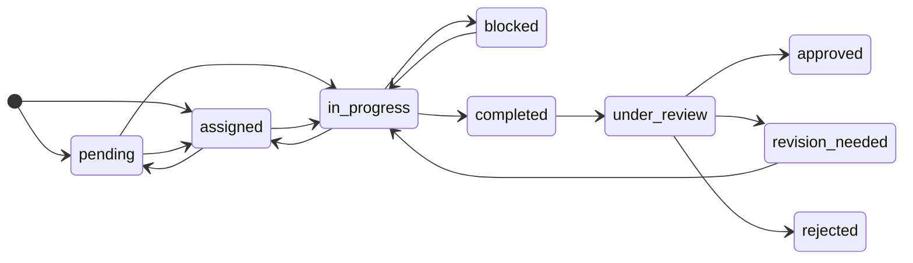

# Task lifecycle

Every task status change goes through one transition service: from the app, from an agent's tools,
from a job, or from the runtime itself. The rules below hold identically on every path, and every
accepted move is recorded with who made it, from which run, and why.

## Statuses

| Status | Meaning |
|---|---|
| `pending` | Created, not yet assigned. |
| `assigned` | Has an assignee, not started. |
| `in_progress` | Being worked on. A bound run moves its task here. |
| `blocked` | Waiting on a person. Set automatically while a run on the task waits for your answer. |
| `completed` | The author says it is done. Waiting for review. |
| `under_review` | Being reviewed. |
| `approved` | Review passed. **Approving merges the task's work into the main branch.** |
| `revision_needed` | Sent back with reasons. Returns to `in_progress`. |
| `rejected` | Will not be done. |

A task is created as `pending` or `assigned`, never further along.

## Every transition

| From | To | Who |
|---|---|---|
| `pending` | `assigned`, `in_progress` | anyone |
| `assigned` | `in_progress`, `pending` | anyone |
| `in_progress` | `completed`, `assigned`, `blocked` | anyone |
| `blocked` | `in_progress` | anyone |
| `blocked` | `assigned` | operator |
| `completed` | `under_review` | anyone |
| `completed` | `revision_needed` | operator |
| `under_review` | `approved`, `revision_needed`, `rejected` | operator, or an agent that is not the author |
| `revision_needed` | `in_progress` | anyone |
| `approved` | `revision_needed` (reopen) | operator |
| `rejected` | `pending` (reopen) | operator |
| `pending`, `assigned`, `in_progress`, `blocked`, `completed`, `revision_needed` | `rejected` | operator |

**Land** (`POST /tasks/{id}/land`, or **Land it** in the app) takes a `completed` task through
`under_review` to `approved` in one operator action, checking every approval rule first.

## Separation of duties

- An agent cannot approve, reject or send back a task it completed, or one it recorded evidence for.
- A task cannot enter `under_review` while it is still assigned to its author.
- An agent changes a task only through its status, its notes, and the requirements it serves.
  Title, assignee, priority and the rest are yours.
- A run may complete only the task it is bound to, and an agent cannot take over another agent's
  assigned task.

## What gates `in_progress`

A task cannot start until every task it depends on is **approved**. Starting one early is refused
with `dependency_unmet`.

## What gates `approved`

Approval is refused, with a reason that says what to do, when:

- a run on the task is still live;
- evidence that would be merged is still awaiting review;
- a requirement it serves has **rejected** evidence (at any rigor);
- at **gate** rigor, a requirement it serves is not verified. At **contract** rigor this is
  reported, not blocking;
- configured **checks** have not passed on the merged result (you may override with a recorded
  reason; agents may not);
- the merge would **conflict**, or an approved prerequisite's work is missing from the task's
  branch.

If approval succeeds but the merge cannot be made safely (no main branch, uncommitted changes to
tracked files, or the checkout on another branch), the merge is **recorded as skipped** and can be
retried.

## Task fields

| Field | Meaning |
|---|---|
| `title`, `description` | What the task is. |
| `assignee`, `assigner` | Who does it, and who asked. |
| `priority` | `low`, `medium`, `high` or `critical`. |
| `requirement_ids` | The requirements it serves (`FR-n`), resolved against its specification. |
| `spec_document` | The specification that declared it. |
| `acceptance_criteria`, `requirements`, `deliverables` | As written in the specification. |
| `depends_on` | Prerequisites, which must be approved before it can start. |
| `loop_id` | The loop whose queue it is in, if any. |
| `notes` | Free notes from the agents and from you. |
